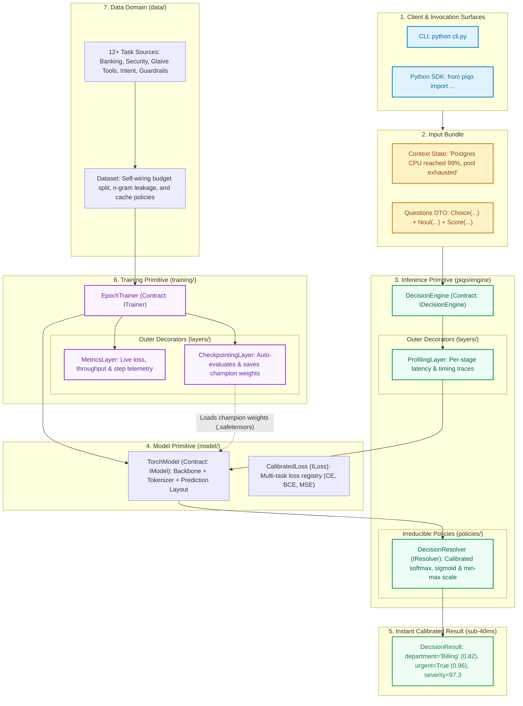

# Piqo

Ultra-fast, calibrated micro-decision engine designed with **Primitive-First Design (PFD)**. Evaluates high-cardinality multi-task questions (classification, boolean decisions, calibrated scores) in single-pass sub-40ms inference.

---

## End-to-End System Map



---

## Architectural Topology & Responsibilities

| Domain | Boundary Contract | Primary Implementation | Role & PFD Discipline |
| :--- | :--- | :--- | :--- |
| **Inference (`inference/`)** | `IDecisionEngine` | `DecisionEngine` | Orchestrates single-pass micro-decisions; strictly decoupled from frameworks. |
| **Inference Policies** | `IResolver` | `DecisionResolver` | Calibrated softmax, sigmoid & min-max scale resolution. |
| **Inference Layers** | Decorator ($\lambda: P \to P$) | `ProfilingLayer` | Non-invasive instrumentation for sub-millisecond stage tracking. |
| **Model (`model/`)** | `IModel` | `TorchModel` | Encapsulates weights, tokenizer layout, and gradient step executions. |
| **Model Policies** | `ILoss` | `CalibratedLoss` | Dynamic loss composition tailored to multi-task question heads. |
| **Training (`training/`)** | `ITrainer` | `EpochTrainer` | Drives multi-epoch model convergence and validation loops. |
| **Training Layers** | Decorator ($\lambda: P \to P$) | `MetricsLayer`, `CheckpointingLayer` | Pluggable telemetry monitoring and champion checkpoint persistence. |
| **Data (`data/`)** | `IDataset` | `Dataset` | Clean ingestion, budget splitting, 13-gram leakage policy, and disk caching. |
| **Benchmark (`benchmark/`)** | `IScorecard` | `Scorecard` | Evaluates engine accuracy & latency against competitive baselines. |

---

## Quickstart

### 1. Run Inference
```python
from piqo import DecisionEngine, Choice, Noul, Score, ProfilingLayer

# Initialize engine decorated with profiling layer
engine = DecisionEngine.from_checkpoint() | ProfilingLayer()

# Run single-pass multi-question evaluation
result = engine.decide(
    state="Postgres CPU reached 99% and connection pool is exhausted.",
    questions=[
        Choice("department", ["Billing", "Infrastructure", "Security"]),
        Noul("urgent", instruction="Is immediate incident response required?"),
        Score("severity", min_value=0.0, max_value=100.0),
    ]
)

print(f"Latency: {result.latency_ms:.2f} ms")
for name, ans in result.answers.items():
    print(f"  {name}: {ans}")
```

### 2. Run Training
```python
from piqo import Dataset, EpochTrainer, MetricsLayer, CheckpointingLayer, TorchModel

# Self-wiring dataset loader
dataset = Dataset()
train_cases = dataset.load("train")
val_cases = dataset.load("val")

# Pipeline composition with decorators
trainer = (
    EpochTrainer(model=TorchModel())
    | MetricsLayer()
    | CheckpointingLayer(output_path="checkpoints/checkpoint_champion.safetensors")
)

# Stream training telemetry
for stats in trainer.fit(train_cases, val_cases=val_cases, epochs=1):
    print(f"Epoch {stats.epoch} | Loss: {stats.loss:.4f} | Val: {stats.val_loss:.4f}")
```

### 3. Interactive CLI
```bash
# Incident triage preset
python -m inference "Postgres CPU at 99%" --preset triage

# Build dataset corpus
python -m data --train-quota 2000 --val-quota 500

# Train model
python -m training --epochs 1 --batch-size 16

# Run benchmark evaluation
python -m benchmark
```

---

## Architectural Principles (Primitive-First Design)

1. **Zero Substrate Leakage in Contracts:** Interfaces (`IDecisionEngine`, `ITrainer`, `IModel`, `IDataset`) exchange pure domain DTOs. Zero token IDs or PyTorch tensors leak across primitive boundaries.
2. **Fractal Directory Topology:** Disk folders match the architectural tree 1:1. The root hosts only sovereign entrypoints; internal strategies live in `policies/`, and decorators live in `layers/`.
3. **The 150-Line Cognitive Limit:** Every source file in the repository fits within human working memory ($\le 150$ lines).
4. **Self-Wiring Primitives:** Every constructor provides production defaults; callers never need to import internal default policies.
5. **Zero Backward-Compatibility Bloat:** Lean, zero-loss functional compression.

