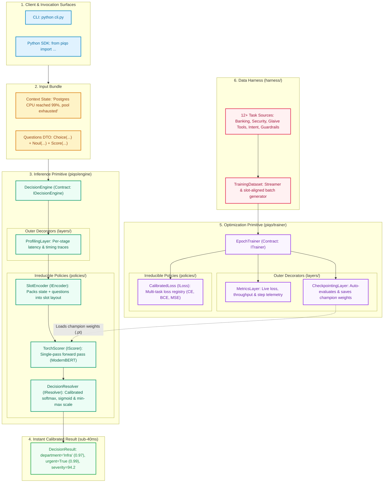

# Piqo

Ultra-fast, calibrated micro-decision engine designed with **Primitive-First Design (PFD)**. Evaluates high-cardinality multi-task questions (classification, boolean decisions, calibrated scores) in single-pass sub-40ms inference.

---

## End-to-End System Map



---

## Architectural Topology & Responsibilities

| Subsystem | Boundary Contract | Implementation | Role & PFD Discipline |
| :--- | :--- | :--- | :--- |
| **Inference** | `IDecisionEngine` | `DecisionEngine` | Orchestrates single-pass micro-decisions; strictly decoupled from frameworks. |
| **Inference Policies** | `IEncoder`, `IScorer`, `IResolver` | `SlotEncoder`, `TorchScorer`, `DecisionResolver` | Discrete sub-primitives handling slot serialization, transformer scoring, and calibration. |
| **Inference Layers** | Decorator ($\lambda: P \to P$) | `ProfilingLayer` | Non-invasive instrumentation for sub-millisecond stage tracking. |
| **Optimization** | `ITrainer` | `EpochTrainer` | Drives multi-epoch model convergence and validation loops. |
| **Trainer Policies** | `ILoss`, `LossRegistry` | `CalibratedLoss` | Dynamic loss composition tailored to multi-task question heads. |
| **Trainer Layers** | Decorator ($\lambda: P \to P$) | `MetricsLayer`, `CheckpointingLayer` | Pluggable telemetry monitoring and champion checkpoint persistence. |
| **Data Harness** | Pure Python Iterators | `TrainingDataset`, Sources | Standardizes 12+ real-world heterogeneous datasets into slot layouts. |

---

## Quickstart

### 1. Run Inference
```python
from piqo import DecisionEngine, Choice, Noul, Score, ProfilingLayer

# Initialize engine decorated with profiling layer
engine = DecisionEngine.from_checkpoint() | ProfilingLayer()

# Run single-pass multi-question evaluation
result = engine.decide(
    state="Postgres CPU reached 99% and connection pool is exhausted.",
    questions=[
        Choice("department", ["Billing", "Infrastructure", "Security"]),
        Noul("urgent", instruction="Is immediate incident response required?"),
        Score("severity", min_value=0.0, max_value=100.0),
    ]
)

print(f"Latency: {result.latency_ms:.2f} ms")
for name, ans in result.answers.items():
    print(f"  {name}: {ans}")
```

### 2. Run Training
```python
from piqo import EpochTrainer, MetricsLayer, CheckpointingLayer
from harness.dataset import TrainingDataset

# Pipeline composition
trainer = (
    EpochTrainer.from_backbone("answerdotai/ModernBERT-base")
    | MetricsLayer()
    | CheckpointingLayer(output_path="checkpoints/checkpoint_champion.pt")
)

train_loader, val_loader = TrainingDataset.loaders("harness/dataset/data/splits/train.jsonl")

# Stream training statistics
for stats in trainer.fit(train_loader, val_batches=val_loader, epochs=3):
    pass
```

### 3. Interactive CLI
```bash
# Terminal playground
python cli.py --play

# Incident triage preset
python cli.py "Postgres CPU at 99%" --preset triage

# View available checkpoints
python cli.py --models
```

---

## Architectural Principles (Primitive-First Design)

1. **Zero Framework Types in Contracts:** Interfaces (`IDecisionEngine`, `ITrainer`, `ILayoutEncoder`, etc.) exchange pure Python DTOs. Zero PyTorch tensors leak across boundary contracts.
2. **Fractal Directory Topology:** Disk folders match the architectural tree 1:1. The root hosts only sovereign entrypoints; internal strategies live in `policies/`, and decorators live in `layers/`.
3. **The 150-Line Cognitive Limit:** Every source file in the repository fits within human working memory ($\le 142$ lines).
4. **Zero Backward-Compatibility Bloat:** High-density, zero-loss functional compression (~1,750 lines end-to-end).
